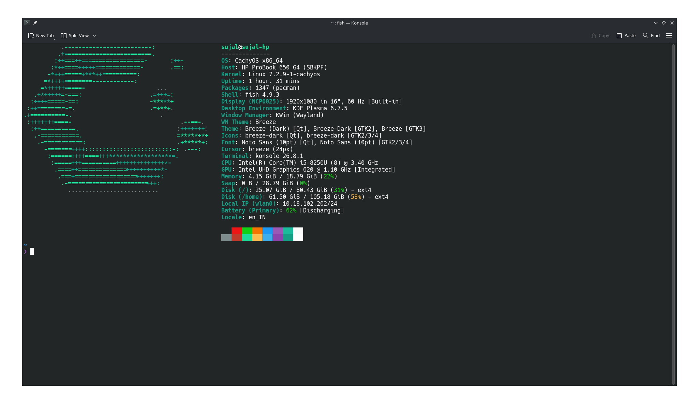
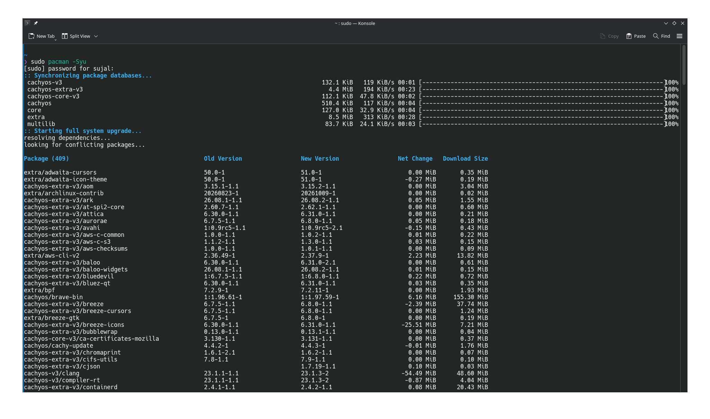
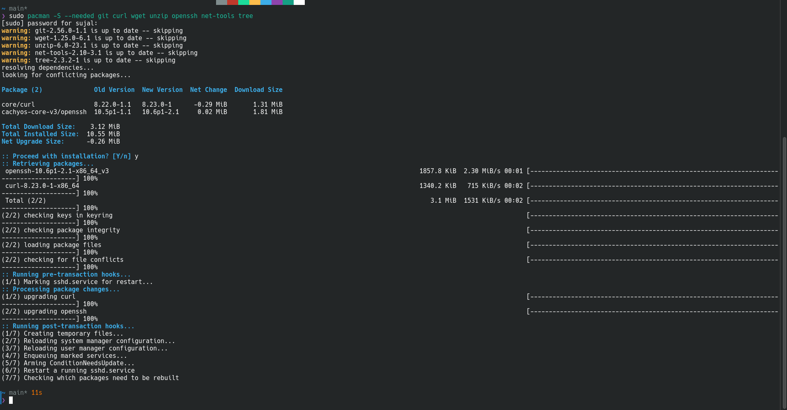
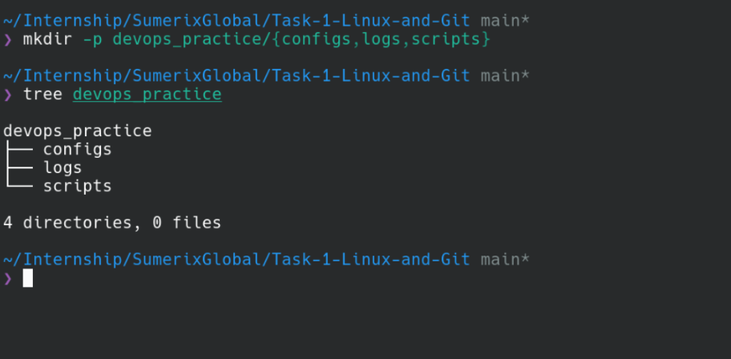
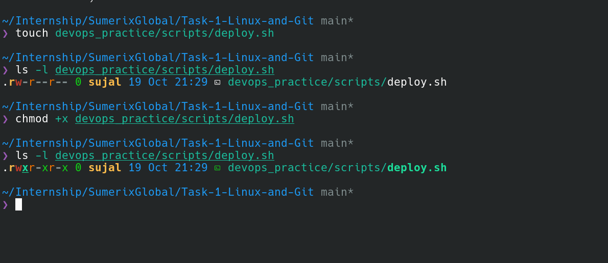
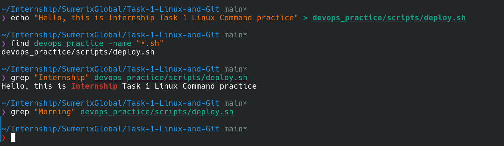
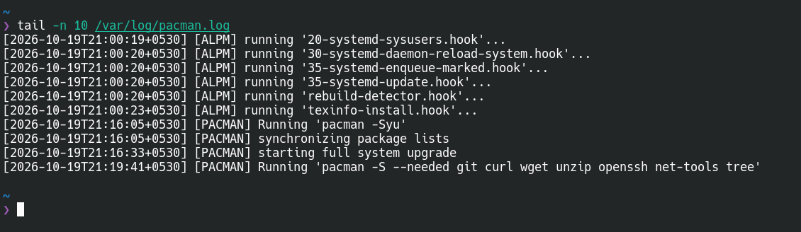
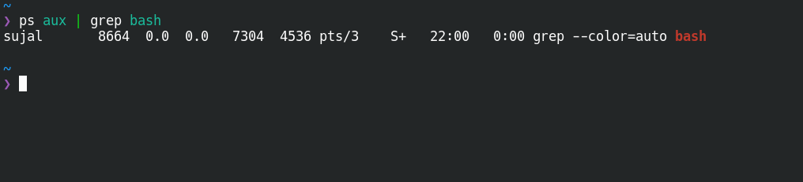
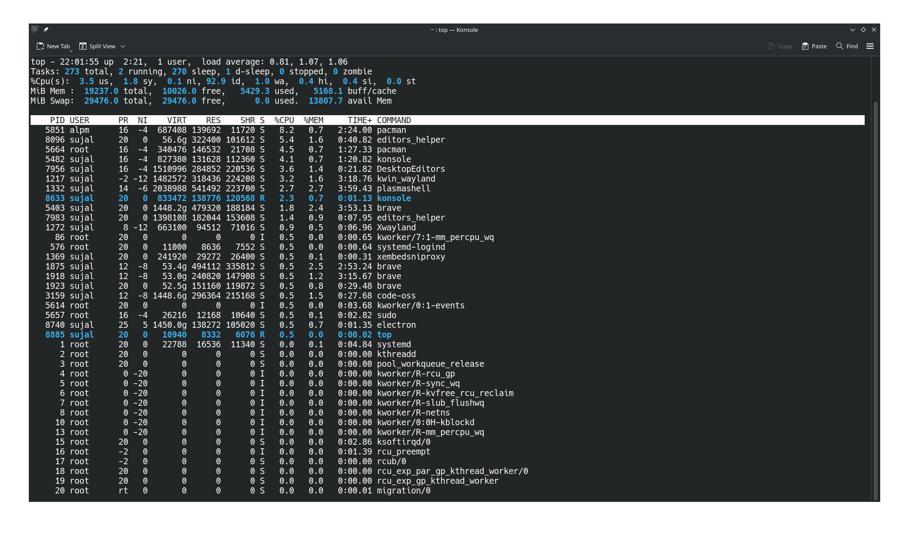
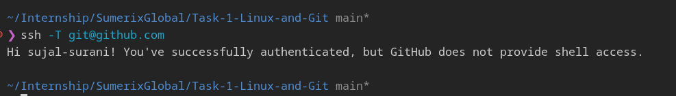

# Installation & Setup Guide

## 1. Operating System
Instead of installing a new Ubuntu OS or a VM or WSL2 instance as described in the task file, I utilized my existing Linux running CachyOS (an Arch Linux-based distribution). This provides a native, highly optimized environment for cloud engineering tasks. It is my primary OS and I have also used many Linux Distros previously - including Fedora, Debian, Arch.

---

## 2. System Update
Since the Linux OS is already provisioned natively, I bypassed the installation phase and proceeded directly to synchronizing the package databases and updating the system.

**Command Executed:**
`sudo pacman -Syu`

---

## 3. Installing Essential DevOps Tools
I installed the required version control, networking, and utility packages required for the internship, adapting the installation commands for the Arch package manager.

**Command Executed:**
`sudo pacman -S --needed git curl wget unzip openssh net-tools tree`

---

## 4. Linux Commands

### Create Directories
**Commands Executed:**
`mkdir -p devops_practice/{configs,logs,scripts}`
`tree devops_practice`

### Change Permissions
**Commands Executed:**
`touch devops_practice/scripts/deploy.sh`
`ls -l devops_practice/scripts/deploy.sh`
`chmod +x devops_practice/scripts/deploy.sh`
`ls -l devops_practice/scripts/deploy.sh`

### Search Files
**Commands Executed:**
`echo "Hello, this is Internship Task 1 Linux Command practice" > devops_practice/scripts/deploy.sh`
`find devops_practice -name "*.sh"`
`grep "Internship" devops_practice/scripts/deploy.sh`
`grep "Morning" devops_practice/scripts/deploy.sh`

### View Logs
As the system is being updated side by side.. The logs also include the logs of system being updated.

**Command Executed:**
`tail -n 10 /var/log/pacman.log`

### Monitor Processes
**Command Executed:**
`ps aux | grep bash`

**Command Executed:**
`top`

---

## 5. Git & SSH Configuration
To satisfy the version control requirements, I verified my pre-configured Git environment and successfully authenticated my SSH connection with GitHub.

**Commands Executed:**
`git config --list`
`ssh -T git@github.com`

