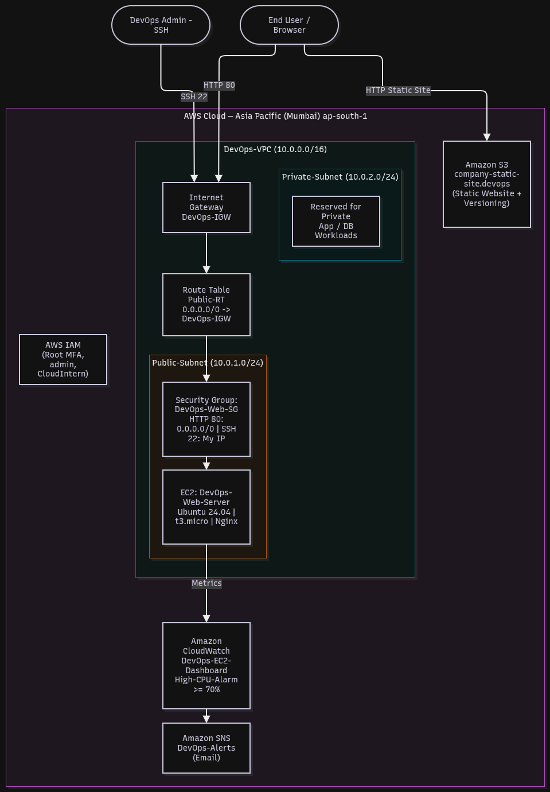

# AWS Cloud Infrastructure Provisioning

**Project:** Cloud Infrastructure Provisioning with AWS — IAM, VPC, EC2, S3 & Secure Networking  
**Region:** Asia Pacific (Mumbai) — `ap-south-1`

## Objective
Transition from a local Linux/Git development environment to Amazon Web Services (AWS) by provisioning a secure, documented, Free Tier-compliant cloud architecture. This environment establishes the identity, networking, compute, storage, and monitoring foundation required for future containerized and automated deployments.

## Architecture Overview


## Provisioned AWS Resources

| Category | Resource Name | Identifier / Configuration |
| :--- | :--- | :--- |
| **IAM** | `admin`, `CloudIntern` | Groups: `AdministratorAccess`, `Interns` (`ReadOnlyAccess`); Root & `admin` MFA enabled |
| **VPC** | `DevOps-VPC` | `vpc-08d3faffa76367380` (`10.0.0.0/16`) |
| **Subnets** | `Public-Subnet`, `Private-Subnet` | `10.0.1.0/24` (auto-assign public IP), `10.0.2.0/24` (isolated) |
| **Internet Gateway** | `DevOps-IGW` | `igw-06c7751ce44e27751` (Attached to `DevOps-VPC`) |
| **Route Table** | `Public-RT` | `rtb-0c4120fc42258745c` (`0.0.0.0/0` → `DevOps-IGW`) |
| **Compute (EC2)** | `DevOps-Web-Server` | `i-0d926427eca31f1b7` (`t3.micro`, Ubuntu 24.04 LTS, Nginx) |
| **Security Group** | `DevOps-Web-SG` | `sg-0d241aa6ad790bdf6` (TCP 80: `0.0.0.0/0`, TCP 22: Admin IP only) |
| **Storage (S3)** | `company-static-site.devops` | Static Website Hosting + Versioning (`index.html`, `logo.png`) |
| **Monitoring** | `DevOps-EC2-Dashboard`, `High-CPU-Alarm` | CPU, Network, EBS metrics; Alarm threshold `>= 70%` via SNS |

## Repository Structure
```text
.
├── diagrams/
│   ├── aws-architecture.drawio(.png)
│   ├── iam-structure.drawio(.png)
│   └── vpc-network.drawio(.png)
├── docs/
│   ├── aws-account-setup.md
│   ├── cost-estimation.md
│   ├── infrastructure-report.md
│   ├── security-notes.md
│   └── troubleshooting.md
├── screenshots/
├── scripts/
│   ├── aws-cli-config.sh
│   └── ec2-setup.sh
├── Infrastructure_Report.pdf
└── README.md
```

## Documentation & Reports
* [AWS Account & IAM Setup](docs/aws-account-setup.md)
* [Full Infrastructure Report](docs/infrastructure-report.md)
* [Cost Estimation (AWS Pricing Calculator)](docs/cost-estimation.md)
* [Security Notes & Best Practices](docs/security-notes.md)
* [Troubleshooting Log](docs/troubleshooting.md)

## Cost Summary
* **AWS Free Tier Monthly Cost:** `$0.00 / month`
* **Standard On-Demand Estimate (`DevOpsEst`):** `$12.42 / month` (`$8.69` EC2 + `$0.73` EBS + `$3.00` CloudWatch + `$0.00` S3)
