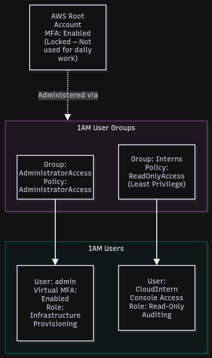

# AWS Account & IAM Setup

## Region Selection
All infrastructure resources for this project were provisioned in **Asia Pacific (Mumbai) (`ap-south-1`)** to minimize latency and keep all dependent networking, compute, and monitoring services within a single region.

## Root Account Security
* Enabled **Multi-Factor Authentication (MFA)** on the AWS root account immediately.
* Locked down the root account and avoided using it for any day-to-day provisioning or administration.

## Why IAM Users Are Preferred Over the Root Account
1. **Blast Radius Reduction:** The root account has unrestricted access to every AWS service and billing setting; if compromised, the entire account is exposed.
2. **Principle of Least Privilege:** IAM allows scoping permissions to exact roles via user groups (e.g., `ReadOnlyAccess` for `CloudIntern`).
3. **Individual Accountability:** Each user gets unique credentials and MFA, making CloudTrail audit logs traceable to a specific person.
4. **Revocability:** Individual IAM user credentials or access keys can be rotated or revoked without disrupting the entire AWS account.

## IAM Configuration Summary
| User | Group | Attached Policy | MFA Status | Purpose |
| :--- | :--- | :--- | :--- | :--- |
| `admin` | `AdministratorAccess` | `AdministratorAccess` | Virtual MFA Enabled | Lab infrastructure provisioning |
| `CloudIntern` | `Interns` | `ReadOnlyAccess` | Console Access | Read-only auditing & least-privilege demonstration |

