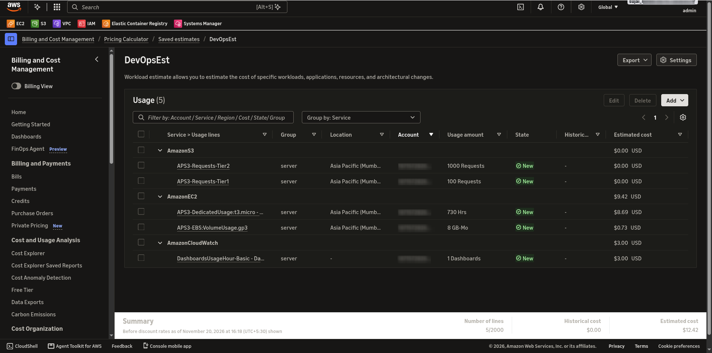

# AWS Infrastructure Cost Estimation

**Region:** Asia Pacific (Mumbai) — `ap-south-1`  
**Billing Model:** AWS Free Tier vs. Standard On-Demand  
**Estimate Name:** `DevOpsEst` (AWS Pricing Calculator)

## Monthly Cost Breakdown

| AWS Service | Configuration | Free Tier (Monthly) | On-Demand (Monthly) |
| :--- | :--- | :--- | :--- |
| **Amazon EC2** | 1x `t3.micro` (Ubuntu 24.04 LTS, 730 hrs/mo) | $0.00 | $8.69 |
| **Amazon EBS** | 8 GB General Purpose SSD (`gp3`) | $0.00 | $0.73 |
| **Amazon S3** | 1,000 GET + 100 PUT requests (Standard) | $0.00 | $0.00 |
| **Amazon CloudWatch** | 1 Custom Dashboard (`DevOps-EC2-Dashboard`) | $0.00 | $3.00 |
| **VPC, Subnets, IGW, RT, SG** | `DevOps-VPC` (`10.0.0.0/16`), 2 Subnets, 1 IGW | $0.00 (Always Free) | $0.00 |
| **AWS IAM** | Users, Groups, Policies, MFA | $0.00 (Always Free) | $0.00 |
| **Total Estimated Cost** | — | **$0.00 / month** | **$12.42 / month** |

## Cost Optimization Practices Applied
* **Right-Sizing:** Provisioned a Free Tier eligible `t3.micro` instance with an 8 GB `gp3` root volume.
* **No Idle Elastic IPs:** Used auto-assigned public IPv4 addressing on `Public-Subnet` instead of allocating paid idle Elastic IPs.
* **Post-Verification Teardown:** Terminated `DevOps-Web-Server` (`i-0d926427eca31f1b7`) and verified zero unattached EBS volumes after capturing all deliverables.
* **Proactive Alerting:** Configured `High-CPU-Alarm` (`>= 70%`) to catch runaway compute usage early.

