

# AWS Cloud Infrastructure Report

**Author:** Sujal Surani  
**AWS Region:** Asia Pacific (Mumbai) — `ap-south-1`

---

## 1. Executive Summary
This report documents the design, provisioning, security configuration, monitoring, and cost estimation of a foundational AWS cloud environment. All components were deployed following AWS Well-Architected best practices while remaining within the AWS Free Tier.

## 2. Architecture & Network Diagrams

### Overall AWS Architecture
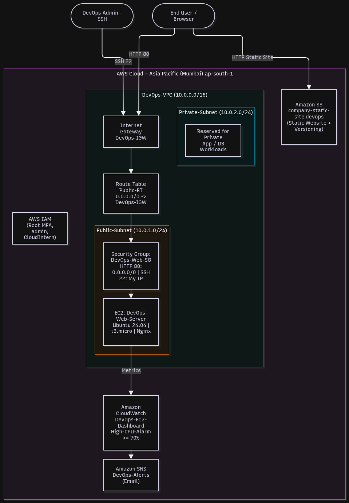

### VPC Network Layout
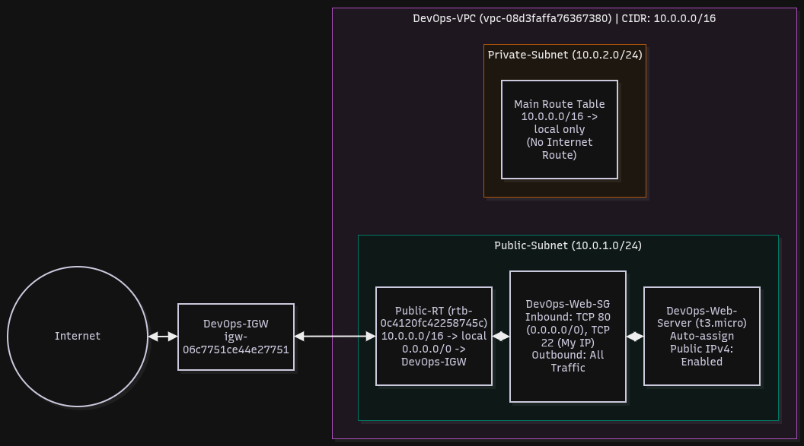

### IAM Access Structure
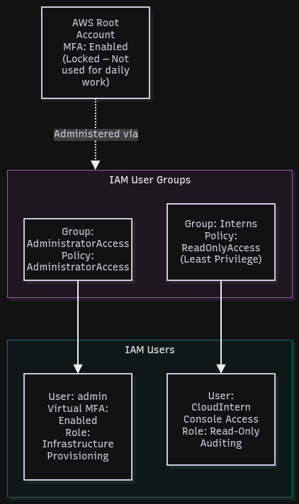

## 3. Resource Inventory

| Service | Resource Name | ID / Details | Status |
| :--- | :--- | :--- | :--- |
| IAM | `admin` / `CloudIntern` | Groups: `AdministratorAccess`, `Interns` | Configured + MFA |
| VPC | `DevOps-VPC` | `vpc-08d3faffa76367380` (`10.0.0.0/16`) | Available |
| Subnet (Public) | `Public-Subnet` | `subnet-0b379d632b39b240e` (`10.0.1.0/24`) | Available |
| Subnet (Private) | `Private-Subnet` | `subnet-0ac70641947ae840b` (`10.0.2.0/24`) | Available |
| Internet Gateway | `DevOps-IGW` | `igw-06c7751ce44e27751` | Attached |
| Route Table | `Public-RT` | `rtb-0c4120fc42258745c` | Associated |
| Security Group | `DevOps-Web-SG` | `sg-0d241aa6ad790bdf6` | Active |
| EC2 Instance | `DevOps-Web-Server` | `i-0d926427eca31f1b7` (`t3.micro`, Ubuntu 24.04) | Verified & Terminated |
| S3 Bucket | `company-static-site.devops` | Versioning + Static Website Hosting | Active |
| CloudWatch | `DevOps-EC2-Dashboard` & `High-CPU-Alarm` | Threshold: `CPUUtilization >= 70%` | State: OK |

## 4. Cost Estimation (`DevOpsEst`)
* **Free Tier Monthly Cost:** `$0.00 / month`
* **On-Demand Monthly Estimate:** `$12.42 / month` (`$8.69` EC2 `t3.micro` + `$0.73` 8 GB `gp3` EBS + `$3.00` CloudWatch Dashboard + `$0.00` S3 requests; VPC & IAM always free).

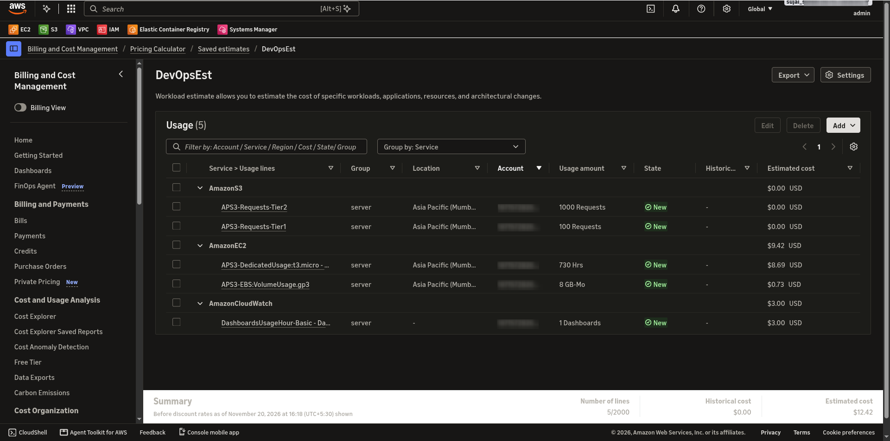

## 5. Verification Screenshots

### IAM Users & Groups
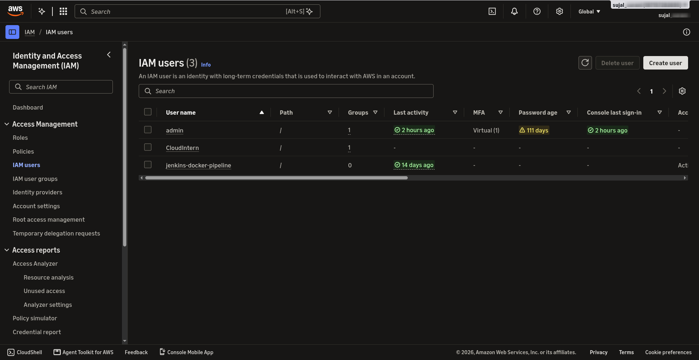

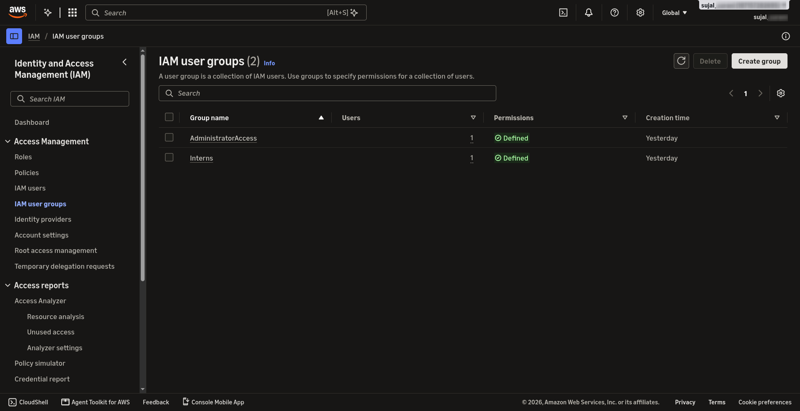

### VPC, Subnets, Internet Gateway & Route Table
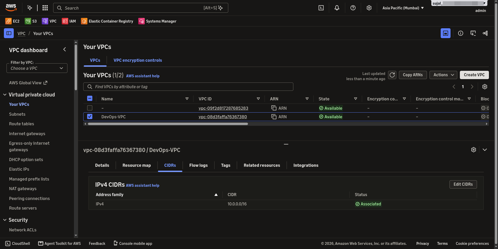
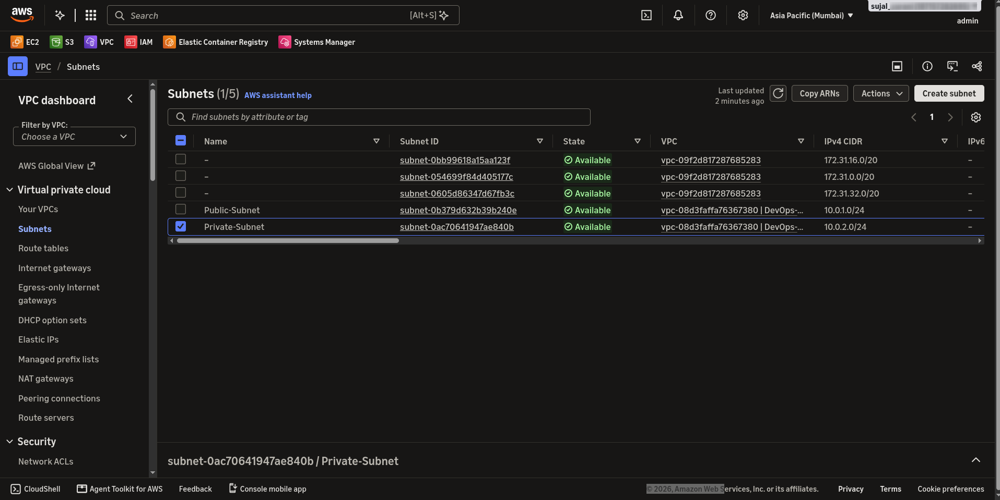
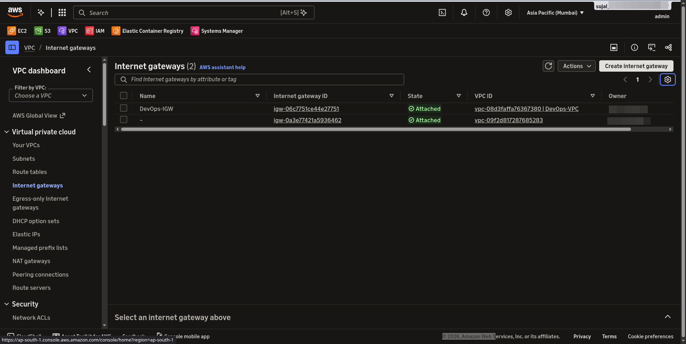
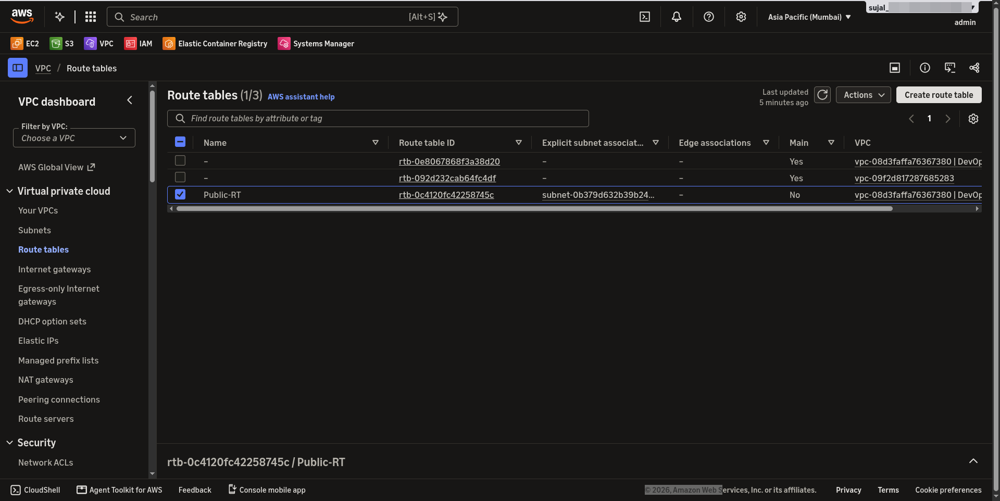

### EC2, Security Group & Nginx Web Server
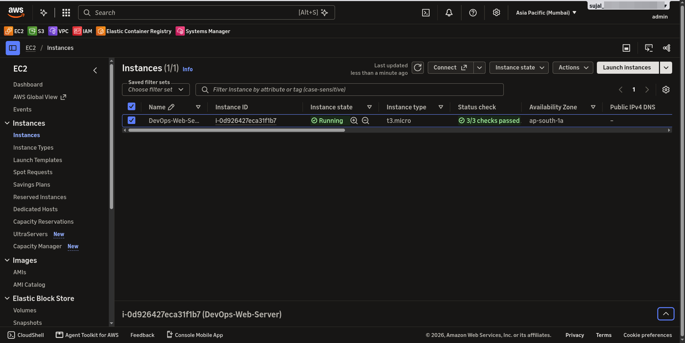
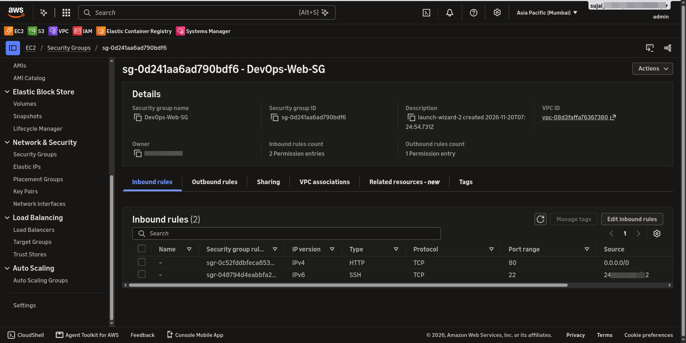
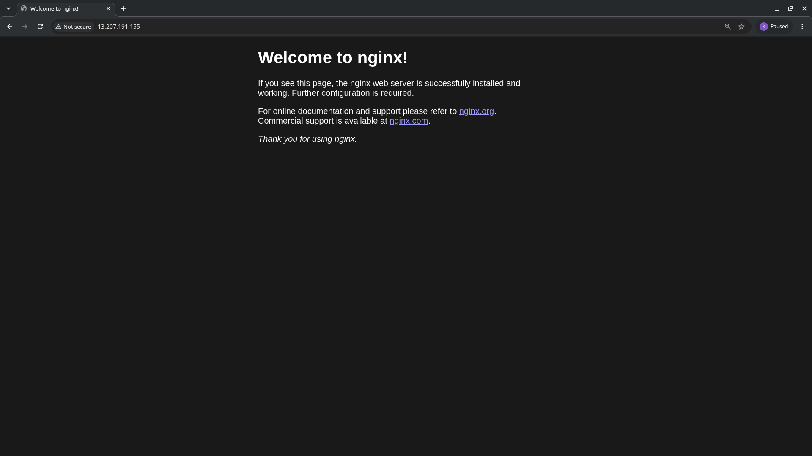

### Amazon S3 Static Website Hosting & Versioning
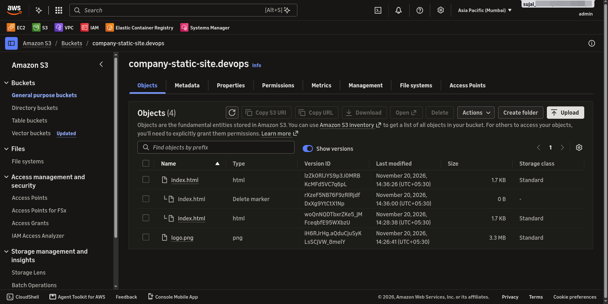
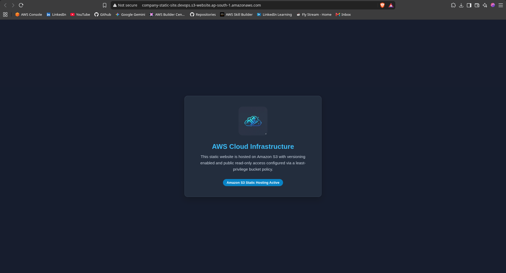

### CloudWatch Monitoring & CPU Alarm
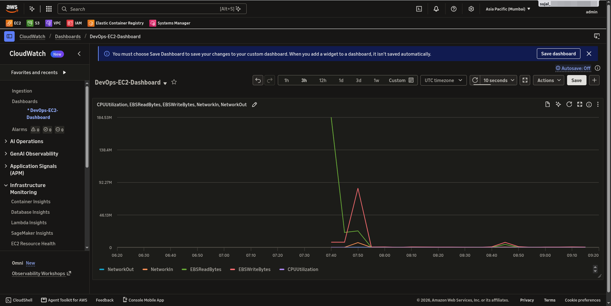
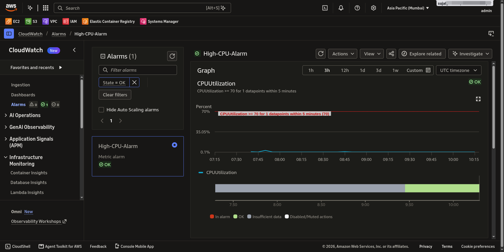
